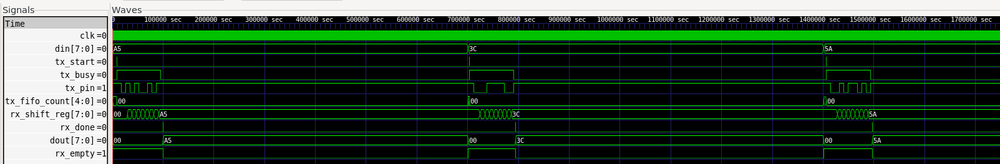

# Parameterized UART Transceiver with Synchronous FIFO Buffers

A synthesizable, parameterized UART (Universal Asynchronous Receiver-Transmitter) core implemented in SystemVerilog. The design features independent TX/RX FIFO buffers, 16x receiver oversampling for noise immunity, a 2-flip-flop synchronizer for asynchronous input metastability resolution, and a self-checking testbench.

---

## Architecture Overview

### Key Modules
* **`fifo.sv`**: Parameterized synchronous First-Word Fall-Through (FWFT) FIFO with combinational read and status flags (`full`, `empty`, `fifo_count`).
* **`uart_tx.sv`**: FSM-based serializer handling standard 8-N-1 framing (1 Start bit, 8 Data bits, 1 Stop bit).
* **`uart_rx.sv`**: Deserializer with a 2-stage flip-flop synchronizer to handle metastability on `rx_pin` and a 16x oversampling engine to align sampling at bit midpoints.
* **`uart_top.sv`**: Top-level integration wiring the FIFOs and UART transceiver logic.
* **`uart_if.sv` & `uart_tb.sv`**: Modular SystemVerilog verification suite featuring non-blocking transactions and automated self-checking scoreboarding.

---

## Specifications

| Parameter | Value |
| :--- | :--- |
| **System Clock** | 50 MHz |
| **Baud Rate** | 115,200 bps |
| **Frame Format** | 8 Data bits, No parity, 1 Stop bit (8-N-1) |
| **Oversampling** | 16x clock ticks per baud bit (RX) |
| **FIFO Depth** | 16 entries (8 bits wide) |

---

## Verification & Simulation Waveforms

The design is fully verified using Icarus Verilog and GTKWave. The self-checking testbench streams arbitrary bytes through the loopback channel and compares transmitted values against received FIFO data.

### Transaction Waveform

* **Serial Framing**: Shows `tx_start` triggering serialization, driving `tx_pin` through the start bit, 8 data bits (LSB-first), and stop bit.
* **Receiver Deserialization**: Demonstrates midpoint oversampling, updating internal shift registers, asserting `rx_done`, and popping valid data into the RX FIFO.

---